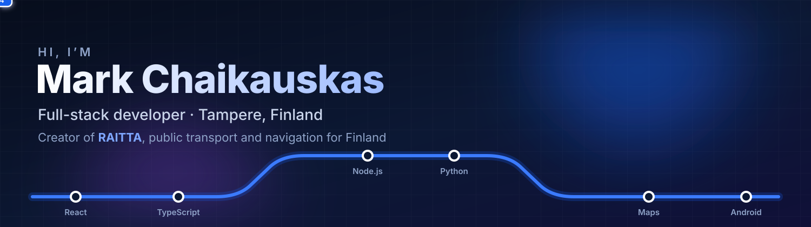

  

## About Me

Hi, I'm **Mark**, also known as **fnvsk**. I'm a 19-year-old **full-stack developer** based in **Tampere, Finland**.

I build things end to end: the interface, the backend, the data behind it and the server it runs on. My main project is **RAITTA**, a public transport and navigation app for Finland that I design, build and run on my own. I learn by doing, so most of what I pick up ends up in a real product people use.

---

## Featured Project

<table>
  <tr>
    <td width="50%" valign="top">
      
    </td>
    <td width="50%" valign="top">
      <b><a href="https://raitta.fi">RAITTA</a></b>  
      <b>What:</b> live buses, trams, metro and trains on the map, a journey planner, timetables, hand-drawn network maps and car navigation for all of Finland, in five languages  
      <b>Try it:</b> <a href="https://maps.raitta.fi">maps.raitta.fi</a> · Android app · Telegram Mini App  
      <b>Code:</b> <a href="https://github.com/fnvsk/raitta-maps">raitta-maps</a>, ideas and pull requests welcome  
      <b>Tech:</b> 
      
      
      
      
      
      
    </td>
  </tr>
</table>

---

## Tech Stack

<table>
  <tr>
    <td width="50%" valign="top">
      <b>Languages</b>  
      
      
      
      
      
    </td>
    <td width="50%" valign="top">
      <b>Frontend</b>  
      
      
      
      
      
    </td>
  </tr>
  <tr>
    <td width="50%" valign="top">
      <b>Backend and data</b>  
      
      
      
      
    </td>
    <td width="50%" valign="top">
      <b>Maps and mobile</b>  
      
      
      
      
      
    </td>
  </tr>
  <tr>
    <td width="50%" valign="top">
      <b>Servers and hosting</b>  
      
      
      
      
    </td>
    <td width="50%" valign="top">
      <b>Tools and AI</b>  
      
      
      
      
    </td>
  </tr>
</table>

## GitHub Analytics

  
  
   
  

---

